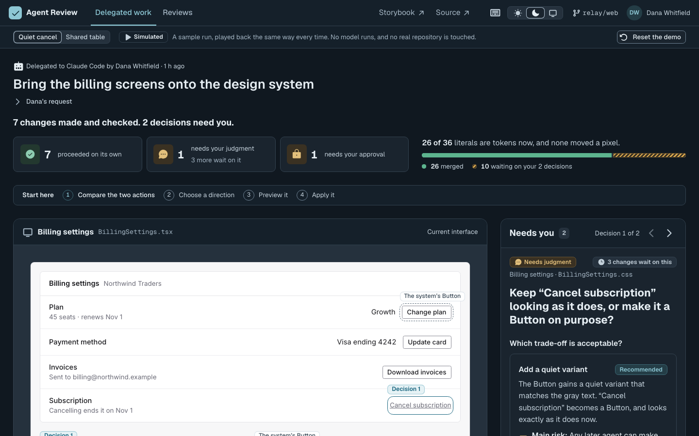
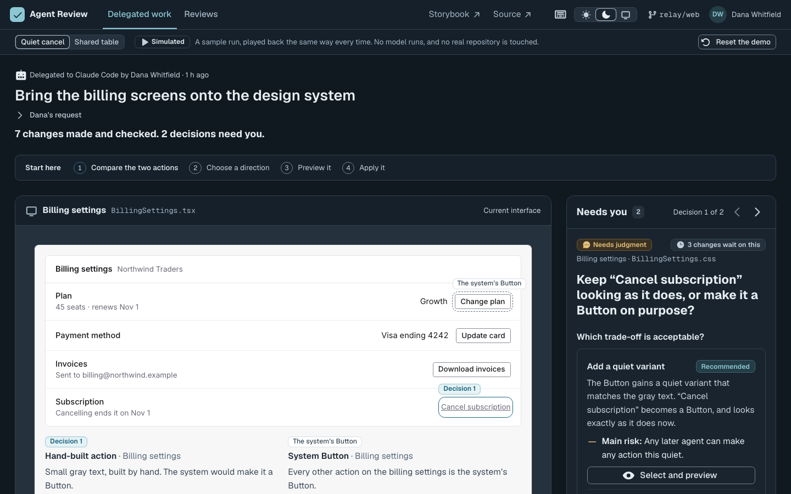
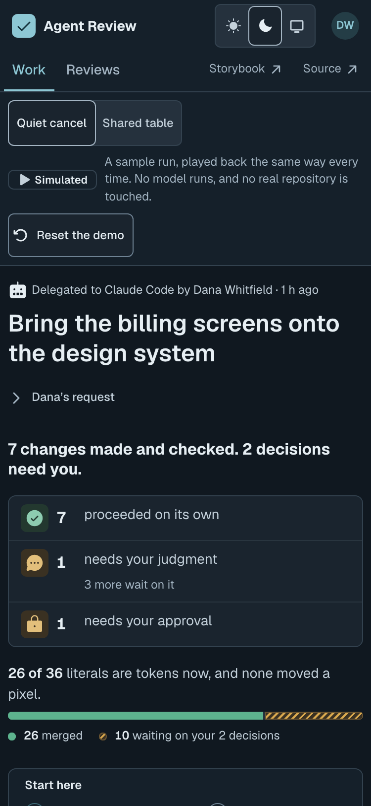
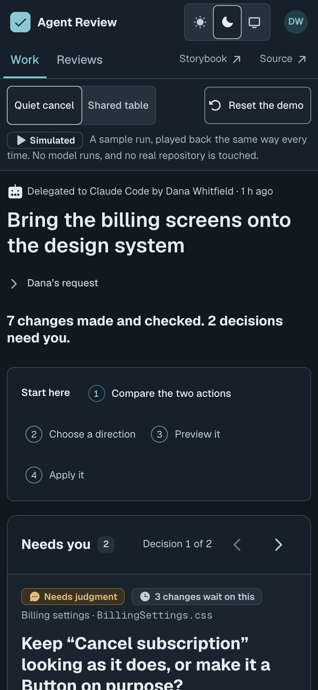
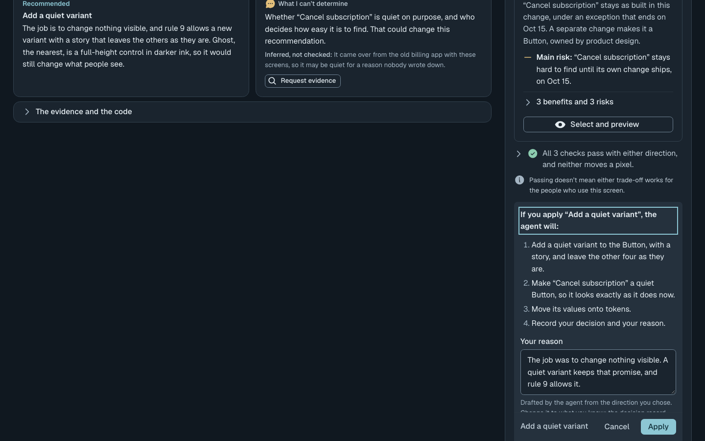
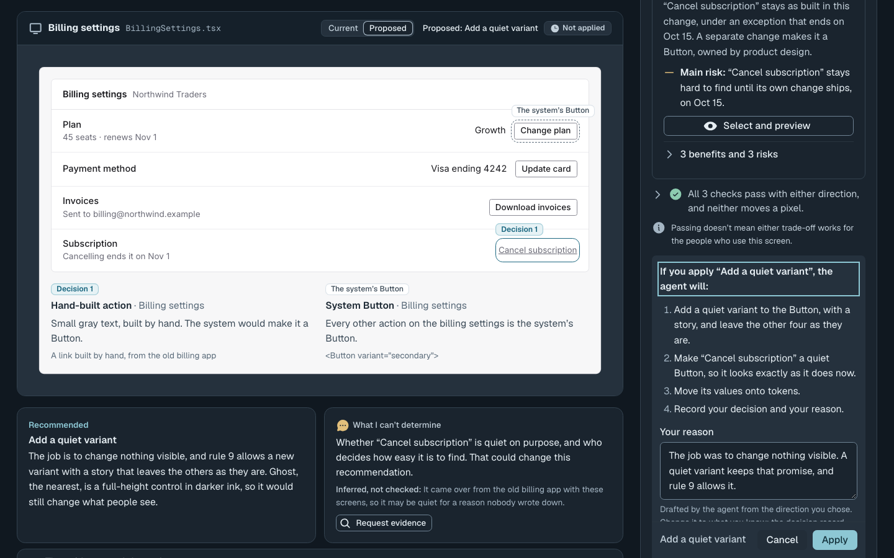
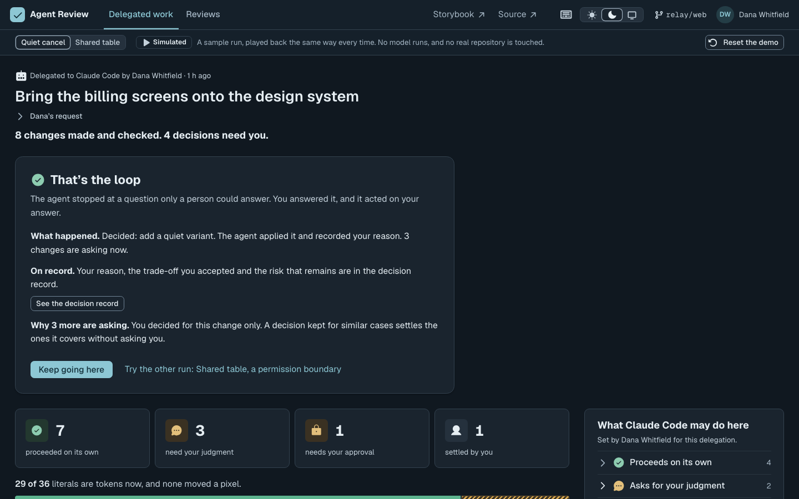

# The first minute (2026-10-23)

Most people who open Agent Review arrive from a link, have never supervised a
coding agent, and give it about a minute. Opened cold, the delegated work
showed them a run bar, an account of four tiles and a bar of literals, and a
preview of billing settings whose four buttons looked pressable and did
nothing. The buttons that move the demo forward were under the fold of a
laptop and more than three screens down on a phone. Applying the first
decision then made "2 decisions need you" read "4", with nothing to say the
person had just done the one thing the screen is for.

The change is five things, each described where it lives:

| What | Where |
| --- | --- |
| The question first: the account's sentence stays at the top, its tiles and bar lead the rest of the run, and the decision comes before the interface in the document | `DelegationScreen.tsx`, FIRST MINUTE; `OutcomeSummary.tsx`, `part` |
| Start here takes you there: each step is a press that brings what it names into view and rings it | `DelegationScreen.tsx`, A STEP TAKES YOU THERE |
| The picture of the product is a picture: its buttons keep their look and lose their press | `Sketch.tsx`, A DRAWING OF A BUTTON IS NOT A BUTTON |
| The interface stays beside the choice: the preview follows on its own when it and the read are too tall to follow together; on a phone, "Show the proposed screen" sits over the plan | `DelegationScreen.tsx`, `useFollow`; `DecisionRequest.tsx`, `see` |
| The first answer ends something: one panel says what it did, why more may be asking, and offers the other run or the next decision | `DelegationScreen.tsx`, THE FIRST MINUTE ENDS |

## Measured

Production builds of `origin/main` at 7037b9f and of this change, served under
`/agent-review/`, measured by `node scripts/first-minute.mjs`. Positions are
page pixels at the page's own zoom (1.125 at a 1440 window).

| | Before | After |
| --- | --- | --- |
| 1440x900: the question's title | 590 to 674 | 495 to 579 |
| 1440x900: the first "Select and preview" ends at | 1028, under the fold | 882, on the first screen |
| 1440x800: the same | 1028 | 882, still 82px under the fold |
| 375x812 phone: the question's title starts at | 2314 | 745, on the first screen |
| 375x812 phone: the first "Select and preview" ends at | 2705 | 1084 |
| Controls in the preview a person can tab to and that do nothing | 4 | 0 |
| Presses of Tab from the top to the first direction | 21 | 18, the four steps of Start here among them |
| 1440x900: the proposed interface in view beside Apply, after selecting | 0% | 100% |
| After the first Apply, focus goes to | "Needs you 4" | "That's the loop" |

## Screens

All at 1440x900 (desktop) or 375x812 at 2x (phone), dark, as a first visit
draws them.

| Before | After |
| --- | --- |
|  |  |
|  |  |
|  |  |
| |  |

Not measured with people. The case study's status line still holds: a
self-directed prototype, not yet tested with users.
